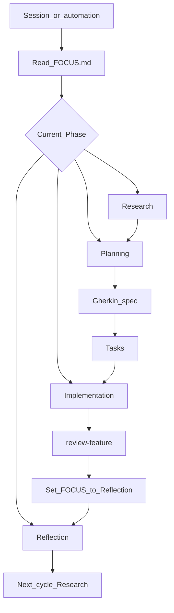

# The loop

The abstract, reusable development loop and its per-Phase playbooks. It does
not describe where any project is right now — that lives in
[`../spec/FOCUS.md`](../spec/FOCUS.md).

A project moves through **Cycles**. Each Cycle runs four **Phases** in order:
Research → Planning → Implementation → Reflection.

## How to run it

- Read [`../spec/FOCUS.md`](../spec/FOCUS.md) for the current Cycle and Phase.
- Execute **only** that Phase, using the playbook below. Skill: `run-loop-phase`.
- Process terms: [`glossary.md`](glossary.md). Method conventions:
  [`conventions.md`](conventions.md). Game terms: [`../wiki/glossary.md`](../wiki/glossary.md).

Reflection is a required Phase and does not run in the background. It runs when
`FOCUS.md` says Phase **reflection** and someone continues the loop (this chat,
a new session, or a scheduled automation).

## Playbooks

### Research / improve

- Read the latest file in `process/reflections/` and the open questions in
  [`../wiki/decisions.md`](../wiki/decisions.md) and
  [`../architecture/open-questions.md`](../architecture/open-questions.md).
- Scan `wiki/` for game-design gaps. Add game terms to `wiki/glossary.md`. Process terms go in `process/glossary.md`.
- Improve the method only if a prior Reflection already approved the change, or the user asked.

### Planning

- Update [`../spec/ROADMAP.md`](../spec/ROADMAP.md) if the high-level view changed.
- Pick the next **Feature**. Scaffold with `new-feature`.
- Gherkin before executable Tasks (spec contract).

### Implementation

- Work Tasks in `spec/<slug>/tasks.md` against the **Gherkin spec**. “Tests pass” is defined in [`glossary.md`](glossary.md).
- When Tasks and walkthrough are done, run `review-feature`.
- After a **ready for Reflection** verdict (and human confirm, unless the user asked to continue), set [`../spec/FOCUS.md`](../spec/FOCUS.md) Phase to **reflection**. Do not skip to the next Cycle.

### Reflection

- Run `reflect-cycle` when `FOCUS.md` is this Phase, or when the user explicitly asks to reflect or close the Cycle.
- Write `process/reflections/cycle-N.md` (close Cycle) or `cycle-N-process.md` (mid-cycle process only).
- Propose concrete edits; apply them here (or wait if the user wants to approve first).
- **Close Cycle:** advance [`../spec/FOCUS.md`](../spec/FOCUS.md) to the next Cycle, Phase **research**.
- **Mid-cycle:** do not change Cycle or Phase; update **Next action** if needed.
