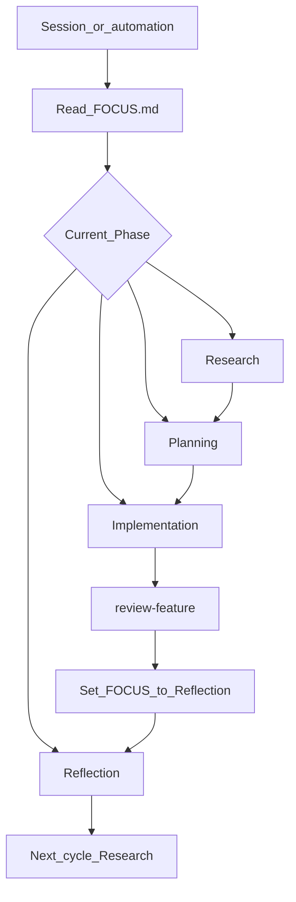

# The loop

Abstract Cycle + Phase order. Live state: [`../spec/FOCUS.md`](../spec/FOCUS.md).
Procedures: [`.cursor/skills/`](../.cursor/skills/).

A project moves through **Cycles**. Each Cycle runs four **Phases** in order:
Research → Planning → Implementation → Reflection.

## How to run it

Read FOCUS. Dispatch with `run-loop-phase` (P10). Reflection is a required
Phase; it runs when FOCUS says **reflection**, or when the user asks to reflect
or close the Cycle.

| Phase | Skill |
| --- | --- |
| Research | `grill-research` |
| Planning | `new-feature` (run `grill-research` first if questions remain) |
| Implementation | execute `spec/<slug>/tasks.md`; then `review-feature` |
| Reflection | `reflect-cycle` (always runs `distill`) |

Terms: [`glossary.md`](glossary.md). Conventions: [`conventions.md`](conventions.md).
Game terms: [`../wiki/glossary.md`](../wiki/glossary.md).
