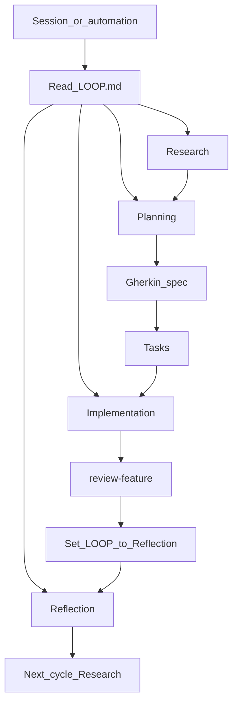

# Phase playbooks

Execute only the current **Phase** from [`LOOP.md`](LOOP.md). Skill: `run-loop-phase`. Terms: [`glossary.md`](glossary.md) (process) and [`../wiki/glossary.md`](../wiki/glossary.md) (game).

Reflection is a required Phase. It does **not** run in the background. The `sessionStart` hook only injects `LOOP.md`. Reflection runs when `LOOP.md` says Phase **reflection** and someone continues the loop (this chat, a new session, or the scheduled automation once it exists).

## Research / improve

- Read the latest file in `process/reflections/` and [`OPEN_QUESTIONS.md`](OPEN_QUESTIONS.md).
- Scan `wiki/` for game-design gaps. Add game terms to `wiki/glossary.md`. Process terms go in `process/glossary.md`.
- Improve process only if a prior Reflection already approved the change, or the user asked.

## Planning

- Update [`spec/ROADMAP.md`](../spec/ROADMAP.md) if the high-level view changed.
- Pick the next **Feature**. Scaffold with `new-feature`.
- Gherkin before executable Tasks (spec contract).

## Implementation

- Work Tasks in `spec/<slug>/tasks.md` against the **Gherkin spec**. “Tests pass” is defined in [`glossary.md`](glossary.md).
- When Tasks and walkthrough are done, run `review-feature`.
- After a **ready for Reflection** verdict (and human confirm, unless the user asked to continue), set `LOOP.md` Phase to **reflection**. Do not skip to the next Cycle.

## Reflection

- Run `reflect-cycle` when `LOOP.md` is this Phase, or when the user explicitly asks to reflect or close the Cycle.
- Write `process/reflections/cycle-N.md` (close Cycle) or `cycle-N-process.md` (mid-cycle process only).
- Propose concrete edits; apply them here (or wait if the user wants to approve first).
- **Close Cycle:** advance [`LOOP.md`](LOOP.md) to the next Cycle, Phase **research**.
- **Mid-cycle:** do not change Cycle or Phase; update **Next action** if needed.
