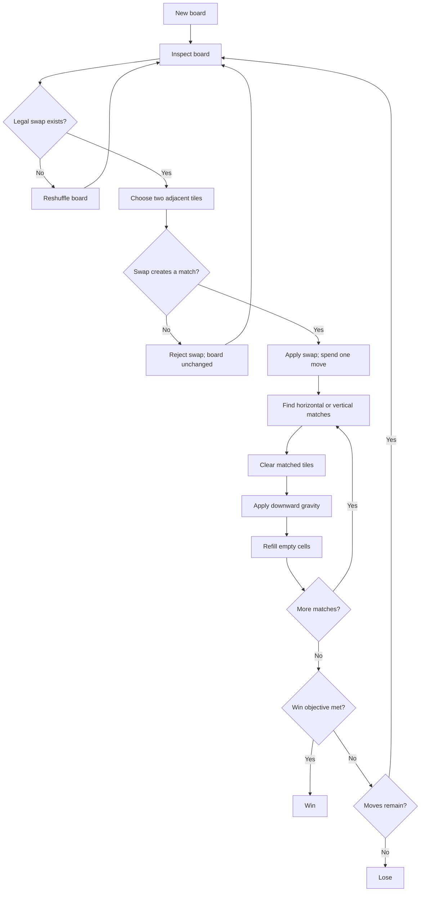

# Match-3 core loop

**Status:** Cycle 1 research — provisional baseline

This note defines the smallest coherent Match-3 rule set for the workflow
fixture. It is a design hypothesis, not a product commitment or an engine
decision. Canonical terms are in [`../glossary.md`](../glossary.md).

## Design intent

- Make every board state understandable at a glance.
- Keep rule outcomes deterministic and independent of animation timing.
- Make the first playable slice small enough to walk through manually.
- Leave special content, progression, and online systems outside the baseline.

## Core loop

## Proposed baseline rules

- The board is a rectangular grid. An **8×8 board** with **six tile kinds** is
  a useful starting point; both values should be tuned through playtesting.
- A **swap** exchanges two orthogonally adjacent tiles. Diagonal swaps are not
  allowed.
- A swap is legal only when it creates at least one **match**. An invalid swap
  is reverted and does not consume a move.
- A match is three or more contiguous tiles of the same kind in a horizontal
  or vertical line. Intersections resolve as one match event.
- All tiles in the current resolution are cleared together. Tiles above empty
  cells fall downward, then new tiles enter from the top.
- Refill can create a **cascade**. Resolution continues until the board has no
  new matches.
- A newly created board should have no immediate matches and should have at
  least one legal swap. A board with no legal swap is reshuffled or regenerated.
- The baseline has no special tiles, blockers, obstacles, boosters, timed mode,
  lives, or multiplayer.

## First playable boundary (G4)

The first slice should demonstrate one complete local session:

1. Start or reset a board.
2. Select two adjacent tiles and attempt a swap.
3. Reject an invalid swap without changing the board.
4. Resolve a legal match, gravity, refill, and any resulting cascades.
5. Show score and remaining moves.
6. Win when a tunable score target is reached; lose when the move budget ends.

A seeded starting board is preferable for repeatable walkthroughs. Rendering
and animation may make the result legible, but they must not define the rule
outcome.

## Art and player model (G5–G6)

- Use placeholders first: high-contrast tiles with a distinct symbol or shape
  in addition to color. This keeps the fixture readable for color-blind users.
- Treat the game as local and single-player. No accounts, server state,
  matchmaking, or network dependency is needed for the fixture.
- Defer original art, narrative, progression, and social features until a
  product need exists.

## Still to validate

- Board size, tile-kind count, score values, and move budget need a short
  playtest rather than being treated as fixed rules.
- The reshuffle policy should preserve the current objective state and avoid
  immediately creating matches.
- Special tiles can be evaluated as a later Feature only after the baseline
  loop is stable.

Platform and engine candidates remain tracked in
[`process/OPEN_QUESTIONS.md`](../../process/OPEN_QUESTIONS.md); this note does
not select either one.
